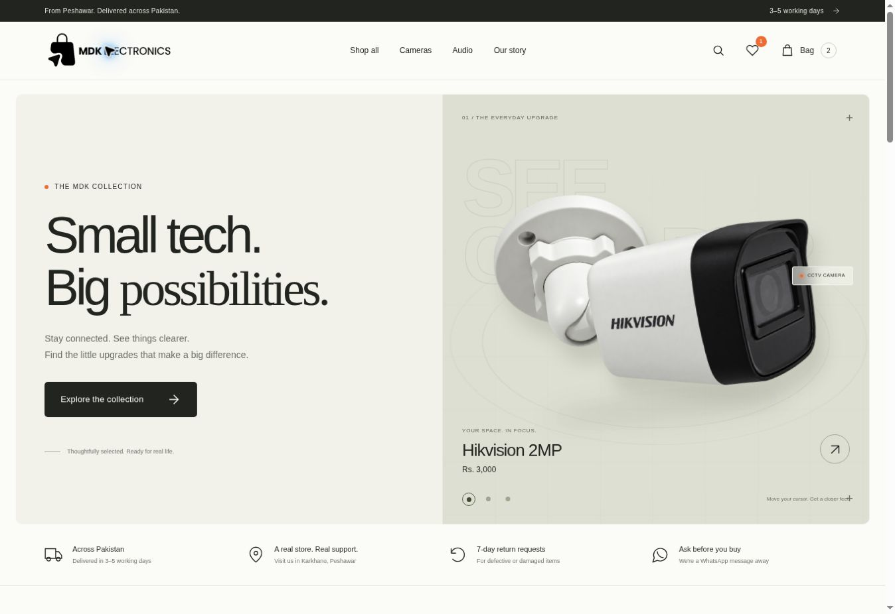
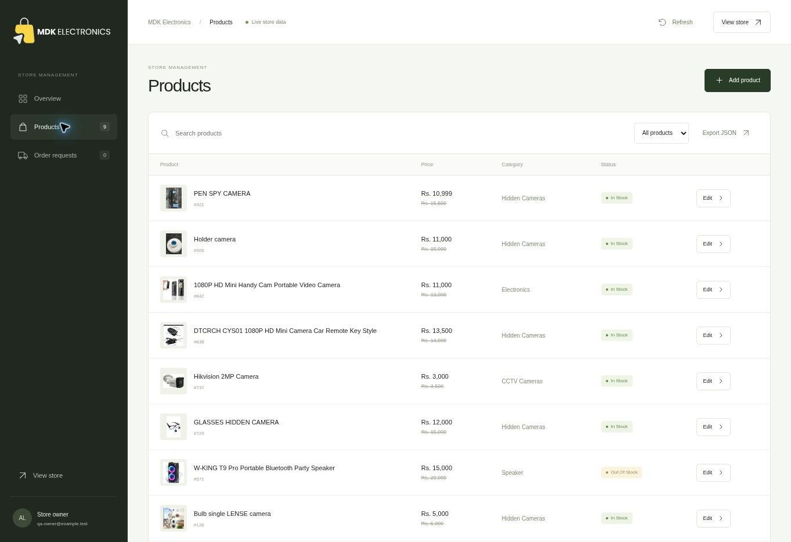

# MDK Electronics

A camera, audio and electronics storefront with a persistent store admin.

**Store:** https://mdk-electronics-preview.asadaly416.chatgpt.site

**Admin:** https://mdk-electronics-preview.asadaly416.chatgpt.site/admin/

The backend preview is owner-private. The custom-domain admin uses an email and personal password. Set the initial password using the private email link on the login screen.



## Storefront

- Short, direct storefront copy; original products, prices and photography.
- Responsive photographic showroom with subtle motion and reduced-motion support.
- Product categories, search, price sorting, stock filtering, wishlist and cart.
- Product galleries, imported policies and contact information.
- Server-rendered product pages and a live catalogue backed by Cloudflare D1.

## Admin



- Dashboard using actual product and request counts.
- Add and edit products, PKR prices, original prices, categories and descriptions.
- Publish products or keep them hidden as drafts.
- Change availability and upload JPG, PNG or WebP images to R2.
- Choose the cover image, reorder/remove photos and export the catalogue as JSON.
- Review customer order requests and update pending/confirmed/dispatched/completed/cancelled statuses.
- Server-side owner authorization, same-origin write checks, input validation and optimistic revision checks.

Admin edits persist across browsers and deployments. The imported catalogue is the initial dataset; D1 overrides take precedence over it. Customer addresses are not stored in localStorage.

## Order requests

Checkout validates the catalogue price and stock on the server, saves a pending request in D1, and opens a WhatsApp message for the customer to review and send. Request references are idempotent, and repeated submissions are rate-limited. No payment is taken automatically. Payment and delivery charges are confirmed by MDK.

Historical WordPress orders, accounts and payment credentials were not imported. This admin manages the new storefront's products and requests.

## Runtime

The persistent backend uses Sites Vinext/Cloudflare Workers, D1 and R2. The Vercel deployment is a Node.js storefront gateway to that same backend; it does not create a second database or a static copy of the catalogue. `/admin/` stays on the custom domain and requires a personal password. Opaque eight-hour sessions are stored as hashes; resetting the password revokes existing sessions.

### Vercel deployment

`vercel.json` disables Next.js framework detection and runs `node scripts/build-vercel.mjs`. This writes the native Vercel Build Output API bundle under `.vercel/output`, containing a Node.js 22 function and an allowlist of public assets. Do not set the Framework Preset to Next.js or the Output Directory to `.next`: Vinext does not emit Next.js manifests. The ordinary `npm run build` remains the Sites Worker build.

Required Vercel server environment variables (production and preview):

| Key | Purpose |
| --- | --- |
| `MDK_SITES_SERVICE_TOKEN` | Private Sites service-access bearer token for this project's backend. Never a browser credential. |
| `STOREFRONT_GATEWAY_SECRET` | At least 32 random characters, identical to the backend runtime secret of that name. |
| `ADMIN_GATEWAY_SECRET` | Separate random server signing secret, identical to the backend runtime secret. |

Configure those values through the hosting providers' secret settings. Do not put credentials in Git, browser JavaScript, or build artifacts. The backend must first be published with the gateway authentication code. Builds do not require secrets; runtime returns an explicit 503 until the connection is configured. A green build alone does not verify deployment readiness.

The storefront and admin use separate short-lived, request-bound HMAC signatures. Admin requests additionally require a valid owner password session. Incoming identity headers are stripped. Guest checkout saves unpaid pending requests; no WhatsApp message is sent automatically. Without the backend connection, checkout explicitly prepares a WhatsApp draft rather than claiming the request was saved.

Admin edits appear on subsequent store reads. Product photos remain in R2.

### Email and password recovery

Set backend runtime secrets `RESEND_API_KEY`, `MAIL_FROM`, `STORE_ORIGIN`, `ADMIN_EMAIL` and `ADMIN_GATEWAY_SECRET`. The Resend key should be sending-only and restricted to the verified store domain. Password links are sent only to `ADMIN_EMAIL`, expire after 15 minutes and work once. Login and reset requests are rate-limited in D1.

The admin Email section has sender name/address, reply-to and order-notification settings. Saving settings requires a signed-in session and current password. Sending addresses must remain on the verified `mdkelectronics.com` domain; notification and reply-to inboxes can belong to the client. A test email and queue retry button are available. Recent activity includes password recovery, verification, tests and order notifications, with provider acceptance IDs and sanitized failures.

To hand over the admin email, the current owner must enter their password and request the change. The new inbox must confirm a single-use 15-minute link before the email changes. Confirmation invalidates all sessions and older reset links. The previous password is disabled; the new owner uses recovery to choose their own password. A pending change can be cancelled. No email change is made automatically.

New requests and status updates produce transactional messages for the configured store inbox and customer, with HTML and plain text. The persistent outbox uses idempotency keys. Sending happens during submission/status updates and manual retry; there is no scheduled retry worker. Provider acceptance is shown separately from inbox delivery; delivery webhooks are not configured. Email bodies and private recovery tokens are never stored in the activity log.

Validate locally with `node scripts/build-vercel.mjs` and `npm test`. Verify the hosted homepage, changed product, uploaded photo, private admin boundary and an authorized test checkout before switching domain DNS.

Requirements: Node.js 24 for the full test suite, or Node.js 22.13+ for the application runtime, with npm.

```bash
npm run install:ci
npm run db:generate  # only after changing the database schema
npm run build
npm test
npm run dev
```

Use the Sites build and publication workflow for the hosted app. The tracked `.openai/hosting.json` retains this Site's identity and declares its `DB` and `BUCKET` bindings. Configure `ADMIN_EMAIL` as a runtime secret matching the verified owner email. Never put its value in frontend code.

For local development, copy `.dev.vars.example` to `.dev.vars` and configure the owner identity in your local test environment. Hosted Sites authentication is dispatch-owned; the local preview does not invent an owner session. Do not expose the Worker behind an untrusted proxy that permits clients to supply identity headers.

Generate migrations with `npm run db:generate`. After building, apply each new SQL migration to the local D1 database once:

```bash
node --import ./scripts/sites-env.mjs ./node_modules/wrangler/bin/wrangler.js d1 execute DB --local --config dist/server/wrangler.json --persist-to .wrangler/state --file drizzle/0000_glorious_leo.sql
```

Hosted migrations are applied by Sites during publication. Local preview data is separate from hosted data.

## Files

| File | Purpose |
| --- | --- |
| `src/render.mjs` | Storefront templates |
| `src/app.js`, `src/styles.css` | Storefront interactions and design |
| `src/admin.js`, `src/admin.css` | Admin UI |
| `server/router.mjs` | Live storefront and protected admin routes |
| `server/api.mjs` | Products, uploads and order requests |
| `server/catalogue.mjs` | Catalogue merge, validation and authorization |
| `db/schema.ts`, `drizzle/` | Persistent schema and migrations |
| `src/catalog.json`, `src/pages.json` | Imported source content |
| `scripts/sync-assets.mjs` | Copies authored client assets for deployment |
| `docs/VERIFICATION.md` | Validation evidence and limits |

## Imported content

Nine electronics products and their galleries were imported from the public WordPress store. The stun-gun listing (832) is excluded. The detailed seven-day damaged-item return policy is preserved; conflicting homepage promises were removed. The current phone number is used consistently.

`npm run sync:wordpress` refreshes the public source snapshot and downloaded images. Existing D1 edits remain authoritative. Review imported text before publication.

The edited `public/images/hikvision-hero-v2.png` is a background-extracted showcase asset; original product photos remain in the galleries. It was created with the built-in imagegen tool using the original camera photo, preserving its geometry and branding while removing the background.
